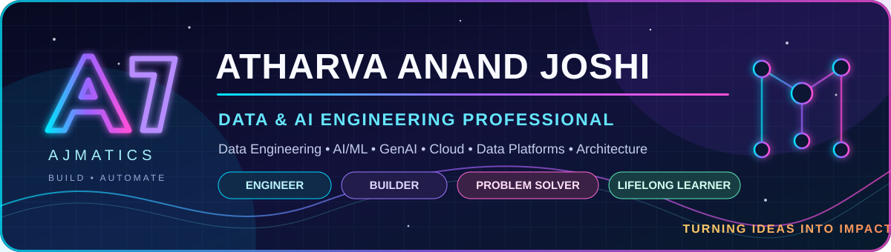
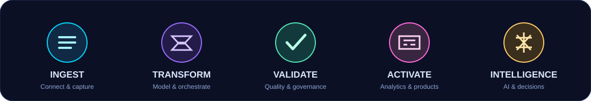

<!--
  AJMATICS | Atharva Anand Joshi
  GitHub profile repository: github.com/atharvajoshi1007
  Visual-first profile: keep the identity, experience, projects and skills accurate when updating.
-->

  
  

---

### ⚡ SOFTWARE ROOTS. DATA-DRIVEN THINKING. AI-POWERED BUILDING.

**I'm Atharva Anand Joshi (AJ) — the person behind AJMATICS.**  
A Data & AI engineering professional building scalable data platforms, intelligent applications and reliable cloud systems.

*Turning data into intelligence, and ideas into impact.*

## 🧬 The journey so far

<table>
<tr>
<td width="25%" align="center"><h3>01</h3><b>Software</b> Application • Backend • APIs</td>
<td width="25%" align="center"><h3>02</h3><b>Intelligence</b> Data Science • ML • GenAI</td>
<td width="25%" align="center"><h3>03</h3><b>Platforms</b> Cloud • Data • Production</td>
<td width="25%" align="center"><h3>04</h3><b>Architecture</b> System Design • Automation</td>
</tr>
</table>

My career has evolved from database and application development through full-stack engineering, machine learning and GenAI into enterprise Data Engineering, cloud data platforms, data quality, governance, migration and AI-powered engineering automation. I enjoy understanding the complete path — **application → API → backend → data → cloud → AI → production → architecture** — instead of looking at only one layer.

**Where I am heading:** Data Engineering + AI → Data / AI Architecture → System Design, Technical Leadership and Consulting.

## 🧑‍🚀 What I build / where I add value

<table>
<tr>
<td width="50%" valign="top">
<h3>🗄️ Data Engineering & Platforms</h3>
ETL/ELT • batch and incremental pipelines • ingestion • integration • migration • transformation • data lakes • warehouses • medallion architecture • analytics-ready datasets.
</td>
<td width="50%" valign="top">
<h3>🛡️ Data Quality & Governance</h3>
Validation • reconciliation • profiling • schema evolution and drift • historical baselines • SCD Type 1/2 • OBT • RBAC • lineage • security • observability.
</td>
</tr>
<tr>
<td width="50%" valign="top">
<h3>🧠 AI / ML / GenAI</h3>
Predictive modelling • forecasting • recommendation systems • NLP • BERT • embeddings • LLMs • RAG • AI agents • LangChain • responsible AI • AI-assisted RCA.
</td>
<td width="50%" valign="top">
<h3>☁️ Cloud, Architecture & Automation</h3>
Azure • AWS • GCP • distributed and event-driven systems • queue-based processing • APIs • system design • production engineering • CI/CD • technical solution design.
</td>
</tr>
</table>

## 💼 Professional journey

<table>
<tr><td width="27%"><b>Ascendion</b> Deployed to ZS Associates · Pune</td><td><b>Senior Data Engineer</b> Feb 2026 – Present AWS data platforms, Redshift, MWAA / Airflow, dbt, Jinja, Fivetran, Python, SQL, data migration, source onboarding, data quality, governance, production support and AI-assisted engineering automation.</td></tr>
<tr><td><b>Mindstix Software Labs</b></td><td><b>Software Development Engineer II</b> Jan 2026 – Feb 2026 Reusable data-quality framework, Python, SQL, Azure Synapse, ADLS, Azure Container Apps, Azure DevOps, Log Analytics, CI/CD, UAT and end-to-end integration.</td></tr>
<tr><td><b>Mindstix Software Labs</b></td><td><b>Member of Technical Staff · Data Engineering</b> Feb 2025 – Dec 2025 Enterprise data platforms, Salesforce integration, Azure data lakes, ADF, Synapse, ADLS Gen2, dbt, Snowflake, AI agents, GA4 / BigQuery, governance and analytics.</td></tr>
<tr><td><b>WorqHat / Winlysis</b></td><td><b>Founder's Team · Full-stack AI / Platform Engineering</b> Aug 2023 – Jan 2025 Official title recorded as VP Engineering; hands-on work across AI-powered SaaS, GenAI, no-code capabilities, AI agents, RAG, MERN, APIs, multi-database backends, GCP and technical coordination.</td></tr>
<tr><td><b>Mindstix Software Labs</b></td><td><b>Member of Technical Staff · Data Science / ML</b> Jan 2023 – Jul 2023 Data visualisation, Power BI, database design, APIs, Python, ML / LLM applications, LangChain, ETL and AWS-based data infrastructure.</td></tr>
<tr><td><b>WorqHat / Winlysis</b></td><td><b>Machine Learning Engineer · Part-time</b> Dec 2022 – Jul 2023 Forecasting solutions for SMEs / MSMEs using Python, Prophet, Flask and GCP Cloud Functions; sparse-data forecasting, transformation, retraining and model evaluation.</td></tr>
</table>

Note: The Mindstix and WorqHat 2023 engagements overlapped; the WorqHat ML work was part-time. The WorqHat title is shown with the practical engineering scope to avoid overstating day-to-day responsibilities.

## 🧑‍💻 Internships & early experience

<table>
<tr><td width="28%"><b>🧩 Cwipedia</b> Jun 2022 – Nov 2022</td><td><b>Flutter Developer</b> · Diploma-Connect app Cross-platform mobile development, responsive UI, Figma, SDLC, CI/CD, code integration, testing, backend coordination, debugging and stakeholder interaction. <a href="https://www.cwipedia.in/">Cwipedia</a></td></tr>
<tr><td><b>🎨 Swapra Technologies</b> May 2022 – Aug 2022</td><td><b>Frontend Developer</b> · Remote Custom portfolio website using HTML, CSS, Bootstrap and JavaScript; responsive UI, chatbot integration, website structure, maintainability and client requirements. <a href="https://github.com/atharvajoshi1007/SwapraTech">Project files</a></td></tr>
<tr><td><b>📊 The Sparks Foundation</b> Oct 2021 – Nov 2021</td><td><b>Data Science Intern</b> Student-performance prediction using Python, Pandas and Scikit-learn; regression, decision trees, data cleaning, preparation and insight presentation.</td></tr>
<tr><td><b>🗃️ Config Solutions</b> May 2019 – Jun 2019</td><td><b>Database Specialist / Intern</b> Database migration and optimisation, manual testing, task coordination, business requirements, BI and backend exposure. Completed the internship with a Pre-Placement Offer (PPO).</td></tr>
<tr><td><b>🚀 Mindstix Software Labs</b> Jan 2023 – Jul 2023</td><td><b>Early engineering training & MTS internship</b> Git workflows, trunk-based development, REST / HTTP, Postman, OAuth 2.0, JWT, RBAC, schema design, Liquibase, FlywayDB, AWS EC2 / S3 / RDS, containers, Jenkins, GitHub Actions, Linux, networking, testing and Agile / Scrum.</td></tr>
</table>

## 🚀 Projects & engineering highlights

<table>
<tr>
<td width="50%" valign="top">
<h3>🏗️ Large-scale Enterprise Data Platform</h3>
Azure · ADF · Synapse · ADLS Gen2 · Functions · ACA · Service Bus · KEDA · Purview · Fabric · Power BI · Python · SQL

Approx. **300 pipelines**, **30M initial records**, **50GB initial data**, **400K daily records** and **71 entities**. Included incremental ingestion, SCD1 / SCD2, OBT, governance and analytics layers.
</td>
<td width="50%" valign="top">
<h3>🛡️ Enterprise Data Quality Framework</h3>
Python · SQL · Synapse · Azure Container Apps · Service Bus · ADLS · Log Analytics

Reusable validation and execution framework with schema checks, profiling, reconciliation, historical / incremental validation, callback-based processing, logging and monitoring.
</td>
</tr>
<tr>
<td width="50%" valign="top">
<h3>🔄 Fivetran Migration & Source Onboarding</h3>
Fivetran · dbt · SQL · Python · Schema Drift

Source migration, schema-drift handling, custom transformation tables and simpler operational maintenance.

**Verified project impact: ~70% reduction in new-source onboarding time.**
</td>
<td width="50%" valign="top">
<h3>🤖 Airflow Copilot · AI-assisted RCA</h3>
AWS MWAA · Apache Airflow · Python · Microsoft Teams · AI

Failure notifications, contextual investigation, earlier issue identification and mitigation before downstream impact.

**Verified project impact: ~60% reduction in debugging time.**
</td>
</tr>
<tr>
<td width="50%" valign="top">
<h3>🧠 AI Agents & GA4 Analytics</h3>
Python · GA4 · BigQuery · LLMs · Responsible AI

AI-agent workflows enriched with business context, seasonality and sentiment signals, with attention to controlled architecture and LLM query-cost optimisation.
</td>
<td width="50%" valign="top">
<h3>☁️ Salesforce Enterprise Data Platform</h3>
Salesforce · ADF · ADLS Gen2 · Synapse · Python · Medallion · Purview · RBAC

Enterprise ingestion, transformation, data modelling, security, governance, compliance, reporting and solution delivery.
</td>
</tr>
<tr>
<td width="50%" valign="top">
<h3>📈 Forecasting & Inventory Optimisation</h3>
Python · Prophet · Flask · GCP Cloud Functions · ML

Forecasting for sparse / smaller datasets, month-to-day conversion, feature preparation, retraining, evaluation and backend integration.

Project records report ~18% forecast-accuracy improvement and ~10% stockout reduction; validate before using as audited claims.
</td>
<td width="50%" valign="top">
<h3>✨ No-code GenAI Builder</h3>
Python · MERN · SQL · Docker · LLMs · RAG · Streamlit

Natural-language querying across structured and unstructured data, retrieval workflows, AI APIs, agents and no-code capabilities.

Project records report ~50% lower dependency on data teams for ad-hoc insights; validate before external use.
</td>
</tr>
<tr>
<td width="50%" valign="top">
<h3>🎯 Recommendation Engine</h3>
Python · SQL · PostgreSQL · BERT · Embeddings · Flask · Firebase · Power BI

Web-data processing, similarity-based recommendations, embedding generation, recommendation APIs and analytics.

Project records report 10K+ similarity queries/day and ~15% compute reduction; validate before external use.
</td>
<td width="50%" valign="top">
<h3>🏢 Enterprise ERP Data Lake & Reporting</h3>
MySQL · Salesforce · ADF · ADLS Gen2 · Azure SQL · Power BI · Tableau

Enterprise ingestion, schema validation, incremental ETL, SCD, Key Vault, Purview, data-lake architecture and reporting.
</td>
</tr>
<tr>
<td width="50%" valign="top">
<h3>🔬 Ad-hoc Data Analysis Utilities</h3>
Python · DuckDB · Pandas · CSV · Parquet

Lightweight data profiling, schema-drift detection, data inspection and ETL validation utilities.
</td>
<td width="50%" valign="top">
<h3>⚡ Smart Energy Multi-agent System</h3>
IIT Patna · AI · ML · LLMs · Model Calling · Multi-agent Orchestration

Academic exploration of an Energy & Power domain architecture with a master orchestrator and specialised agents.
</td>
</tr>
</table>

<b>🗂️ Earlier builds & additional project work</b> — open to explore

- **Diploma-Connect app** — Flutter-based cross-platform mobile application developed during the Cwipedia experience. The old repository URL from the earlier README returned 404 during verification, so it is not presented as a live source-code link.
- **SwapraTech portfolio website** — HTML, CSS, Bootstrap and JavaScript, with responsive UI and chatbot integration. [Project files](https://github.com/atharvajoshi1007/SwapraTech).
- **AI Interview Assist** — Chrome-extension product concept with AI-enabled interview assistance.
- **GenAI no-code workspace capabilities** — LLM integrations, data querying, APIs and agent-style workflows.
- **Student performance prediction** — regression and decision-tree modelling during The Sparks Foundation internship.

For public code and repositories, explore the <a href="https://github.com/atharvajoshi1007?tab=repositories">complete GitHub repository list</a>. Some enterprise projects are described at capability level because implementation details are not public.

## 🧰 The full tech universe

A broad inventory across professional work, projects and learning. This is intentionally more complete than a role-specific skills shortlist; hands-on depth varies by technology.

### 👨‍💻 Languages & development

### 🏞️ Data engineering, integration & orchestration

### ☁️ Cloud & platform services

### 🗃️ Databases, storage & formats

### 🧠 Artificial intelligence, machine learning & GenAI

### 🧱 Application engineering, DevOps & delivery

### 🏢 Enterprise, analytics & product tools

### 🏛️ Architecture & engineering practices

`Data Platform Architecture` · `Enterprise Data Lake` · `Data Warehouse Architecture` · `Medallion Architecture` · `Data Modelling` · `System Design` · `Solution Design` · `Cloud Architecture` · `Distributed Processing` · `Event-driven Architecture` · `Queue-based Architecture` · `Asynchronous Processing` · `Callback Architecture` · `Batch Processing` · `Incremental Processing` · `Multi-database Architecture` · `API Design` · `Backend Architecture` · `Security` · `Compliance` · `Data Lineage` · `Observability` · `Reliability` · `Scalability` · `Maintainability` · `Modularity` · `Reusability` · `Cost Optimisation` · `Production Resilience` · `Technical Leadership` · `Requirement Gathering` · `Business Analysis` · `Stakeholder Management` · `Client Collaboration` · `Technical Communication` · `Agile` · `Scrum` · `Kanban` · `DevOps` · `SRE`

`Backend Development` · `Full-stack Development` · `API Development` · `API Specifications` · `Code Reviews` · `Data Analytics` · `Data Modelling` · `Data Integration` · `Data Validation` · `Data Reconciliation` · `Data Warehousing` · `LLM Orchestration` · `AI Automation` · `Multi-cloud Engineering` · `Cloud-native Architecture` · `Failure Detection & Mitigation` · `Incident Handling` · `Production Support` · `Cross-functional Collaboration` · `Client Interaction` · `Business-aligned Solution Delivery` · `Authentication & Authorisation` · `Model Retraining` · `Model Evaluation`

## 🏅 Highlights & credentials

<table>
<tr><td align="center" width="33%"><h1>70%</h1><b>Faster source onboarding</b> Fivetran migration</td><td align="center" width="33%"><h1>60%</h1><b>Less debugging time</b> Airflow / AI-assisted RCA</td><td align="center" width="33%"><h1>9.45</h1><b>B.Tech CGPA / 10</b> MIT Academy of Engineering</td></tr>
</table>

- **[Microsoft Certified: Azure Fundamentals](https://www.credly.com/badges/4ec883d1-e89f-4512-81c7-4fd480831409/public_url)**
- **Oracle Cloud Infrastructure 2021 – Certified Architect Associate**
- **Amazon Product Data Scraping Crawler Making Competition** – Certificate of Participation

## 🎓 Education

| Institution | Qualification | Details |
|---|---|---|
| **Indian Institute of Technology (IIT), Patna** | Executive M.Tech · AI & Data Science Engineering | Working-professional programme · Feb 2024 – Present |
| **MIT Academy of Engineering, Alandi, Pune** | B.Tech · Information Technology | May 2023 · **9.45 / 10 CGPA** |
| **Government Polytechnic, Ahmednagar** | Diploma · Computer Science / Advanced Data Management | **~9.29 / 10 CGPA** |

## 🔭 Research & interests

**Professional curiosity**  
AI/ML research · Generative AI · LLM applications · RAG · AI agents · responsible AI · data engineering · modern data stack · cloud data platforms · data architecture · distributed systems · system design · production reliability · data governance · analytics · optimisation · technical leadership · consulting · product thinking · management.

**Outside the terminal**  
Data structures & algorithms (C++) · SQL / NoSQL databases · Flutter and mobile applications · Java application development · Cloud databases & operations · Project management · Travelling · Drawing · Cooking · Fitness / Gym · Marvel movies · Cartoons.

## ✍️ Writing, ideas & technical notes

I also share practical learning and technical perspectives on AI, cloud platforms, machine learning and analytics. A few pieces from my <a href="https://medium.com/@atharvajoshi1007">Medium profile</a>:

<table>
<tr><td width="50%" valign="top">🧠 <b><a href="https://medium.com/@atharvajoshi1007/aws-sagemaker-vs-azure-ml-studio-a-practical-comparison-for-architecting-deploying-business-fc01f4114313">AWS SageMaker vs Azure ML Studio</a></b> Architecture, deployment and business use-cases · Oct 2025</td><td width="50%" valign="top">⚡ <b><a href="https://medium.com/@atharvajoshi1007/revolutionizing-the-sustainable-energy-sector-with-generative-ai-5009aec678b4">Generative AI for the Sustainable Energy Sector</a></b> Applied GenAI and energy-management ideas · Jan 2025</td></tr>
<tr><td width="50%" valign="top">☁️ <b><a href="https://medium.com/@atharvajoshi1007/building-intelligent-solutions-with-generative-ai-on-azure-a-developers-perspective-ae302c7be069">Building Intelligent Solutions with GenAI on Azure</a></b> Azure AI, RAG and scalable application design · Jan 2025</td><td width="50%" valign="top">📊 <b><a href="https://medium.com/@atharvajoshi1007/market-basket-analysis-for-everyone-2173c50993e7">Market Basket Analysis for Everyone</a></b> Apriori, FP-Growth and ECLAT · Dec 2024</td></tr>
</table>

<b>More writing</b>

- <a href="https://medium.com/@atharvajoshi1007/how-to-choose-the-perfect-recommendation-model-a-beginners-guide-3c2dedb0afd8">How to Choose the Perfect Recommendation Model</a>
- <a href="https://medium.com/@atharvajoshi1007/revolutionizing-boundless-potential-with-langchain-and-llm-fb42e9dc71c0">Revolutionizing Boundless Potential with LangChain and LLM</a>

## 📊 GitHub playground

### 🐍 Contribution snake

## 🤝 Connect with me

### Thanks for dropping by!

**Dream • Build • Learn • Share • Grow**  
*— Atharva Anand Joshi | AJMATICS —*

<!--
  Identity: Atharva Anand Joshi | Atharva Joshi | AJ | AJMATICS
  Focus: Data Engineering | Data Science | AI | ML | GenAI | Cloud | Data Architecture
-->
